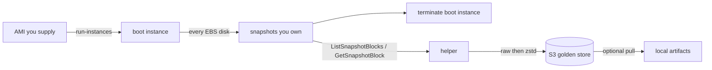

# aws-firmware-dump

Acquire the disks of an AMI **you can already launch** into a private S3 bucket.
No catalog, no product list, no baked-in AMI ids. You pass the AMI id.

S3 is the store. Boot, snapshot, compress, and upload all run inside AWS. Local
bandwidth is used only if you later pull a specific object.

## What it does



1. Launch the AMI in this stack's VPC. No SSH, no key pair, no inbound ports.
2. Snapshot **every** EBS volume on that instance (root and data disks), then
   terminate it. Snapshots are taken first because marketplace images usually
   set `DeleteOnTermination`.
3. A small Amazon Linux helper reads those snapshots over the EBS direct APIs
   and streams `raw | zstd | aws s3 cp -`. No volume is created or attached.
4. Record sha256 of the compressed stream plus AMI name, owner, architecture,
   and product codes in `manifest.json`.

## What it does not do

- It does not search for AMIs, subscribe you to a listing, or pick a target.
- It does not copy an AMI across regions. The AMI must already exist in `region`.
- It does not accept Marketplace terms. `OptInRequired` is a console step.
- It will not launch an AMI this account cannot launch.

Only dump images you are entitled to run. Keep the artifacts private. A
Marketplace software fee, if the listing has one, accrues only while the boot
instance is running.

## Why the read path is the EBS direct APIs

AWS does not give buyers the snapshot behind a Marketplace AMI. `copy-image`
and `create-volume` against that snapshot fail. Booting the AMI creates a
volume **this account owns**, and that volume can be snapshotted.

A volume that still carries a Marketplace product code can only be attached as
the root device of a stopped instance, so attaching it to a helper as a data
disk does not work. `ListSnapshotBlocks` + `GetSnapshotBlock` return the bytes
over HTTPS with no attach. Unallocated blocks are emitted as zeros so offsets
stay correct.

The direct API speaks CBOR with PascalCase members. `Checksum` is base64 of the
raw digest, not hex. `ebs_snapshot_read.py` handles both.

## Prerequisites

- Terraform >= 1.6, AWS provider >= 6
- AWS CLI v2, `jq`, `flock`, and credentials that can apply the stack and run
  the instance/snapshot/SSM/S3 calls below
- `zstd` only for `unpack.sh`
- The AMI visible in the stack's region, and a boot instance type that listing
  allows

Operator permissions used by the scripts (the helper role is separate, and is
created by Terraform):

- `ec2:DescribeImages`, `DescribeInstances`, `DescribeSnapshots`, `RunInstances`,
  `TerminateInstances`, `CreateSnapshot`, `DeleteSnapshot`, `CreateTags`,
  `RegisterImage`
- `iam:PassRole` on the helper instance profile
- `ssm:GetParameter`, `SendCommand`, `GetCommandInvocation`,
  `DescribeInstanceInformation`
- `s3:*` on the artifact bucket (get/put/list/delete/head)
- `sts:GetCallerIdentity`

## Quickstart

```bash
cd terraform && cp terraform.tfvars.example terraform.tfvars
# edit region / name_prefix if needed — still no AMI ids
cd ..
make init && make apply && make configure

make probe AMI=ami-0123456789abcdef0
make dump  LABEL=my-image AMI=ami-0123456789abcdef0
make ls
```

`ami-0123456789abcdef0` is a placeholder. Replace it with an AMI id this
account can launch.

`make apply` creates a VPC, an egress-only security group, an S3 bucket, and
the helper IAM role. It does not start billable compute unless
`helper_enabled = true`. The VPC has no NAT gateway, so idle cost is the bucket
only (and that is empty until you dump something).

## Acquiring an image

```bash
scripts/dump.sh --ami ami-0123456789abcdef0 --label my-image
scripts/dump.sh --ami ami-0123456789abcdef0 --label my-image --boot-type m5.2xlarge --dwell 60
scripts/dump.sh --ami ami-0123456789abcdef0 --label my-image --dry-run
scripts/dump.sh --ami ami-0123456789abcdef0 --label my-image --snapshot-id snap-0123456789abcdef0
```

`--dry-run` describes the AMI and prints the plan. It does not launch.

Defaults:

| Flag | Default | Notes |
|---|---|---|
| `--boot-type` | `m5.xlarge`, or `m6g.xlarge` if the AMI is `arm64` | Listings often reject other types. The AWS error names the ones they allow. |
| `--dwell` | `180` | Seconds the guest runs before snapshot. `0` snapshots as soon as the instance is running. |
| `--workers` | `32` | Concurrent `GetSnapshotBlock` calls per disk. |

Labels must match `^[A-Za-z0-9][A-Za-z0-9._-]{0,62}$`. They become S3 keys.

A re-run skips a label whose object is already in S3 and whose sha256 is in
the manifest. `--force` fetches again.

### Several images

`images.tsv`, one image per line. Blank lines and `#` comments are ignored.
The third field is an optional instance type.

```
# LABEL            AMI                          BOOT_TYPE
my-image           ami-0123456789abcdef0
other-image        ami-0123456789abcdef0        m5.2xlarge
```

```bash
make dump-batch BATCH=images.tsv JOBS=2
```

`--jobs N` gives each worker its own helper slot. Manifest updates are locked
with `flock`. Two separate driver processes can share `manifest.json`; give
them different `DUMP_STATE_DIR` values if they must not share a helper slot file.

### Marketplace terms

```bash
make probe AMI=ami-0123456789abcdef0
```

`run-instances --dry-run` is free. `DryRunOperation` means the account can
launch it. `OptInRequired` means accept that listing in the AWS console, then
probe again. This repo will not accept terms for you.

### Resume, register, keep

- `--snapshot-id` skips boot and reads one existing snapshot. Single image only.
- `--register-ami` registers a launchable AMI in this account from the snapshots
  just taken, and keeps those snapshots. They are billed per GB-month.
- `--keep-snapshot` keeps the snapshots without registering an AMI. Cleanup
  skips snapshots tagged `Keep=true` unless you pass `--force`.

## After it is in S3

```bash
make ls                  # keys + manifest, no download
make watch               # in-flight helper log, multipart upload size
make pull LABELS="my-image"
make pull LABELS="my-image" RAW=1    # also write a sparse .raw
scripts/unpack.sh my-image           # partition metadata next to the raw
```

`pull` checks sha256 of the compressed object before it records the label as
downloaded. `unpack` writes a sparse raw image under `artifacts/raw/` and a
`.diskmeta.txt` (`file`, `sfdisk`, `blkid`, `parted`). Mount with
`losetup -Pf --show artifacts/raw/<label>.raw`.

## S3 layout

```
s3://<bucket>/
  golden/<label>/<label>.raw.zst
  golden/<label>/<label>.raw.zst.sha256    # checksum of the compressed stream
  golden/<label>/<label>.stats.json
  golden/<label>/<label>.<device>.raw.zst  # extra disks, root is the unsuffixed object
  _scripts/snapshot_to_s3.sh
  _scripts/ebs_snapshot_read.py
  _status/<label>.json                     # expires after 7 days
  _logs/<label>.log                        # expires
```

`golden/` has no lifecycle expiry. Incomplete multipart uploads are aborted
after 3 days. `terraform destroy` deletes the bucket (`force_destroy = true`),
including `golden/`.

`manifest.json` (local, gitignored) is the index: AMI id, name, owner,
architecture, product codes, per-disk keys, sha256, sizes, fetch time.

## Commands

```
make init / plan / apply / destroy
make configure
make probe AMI=ami-...
make dump LABEL=name AMI=ami-... [BOOT=type] [DWELL=seconds]
make dump-batch BATCH=images.tsv [JOBS=n]
make watch / ls / pull / unpack
make list
make cleanup                 # tagged resources only
make cleanup FORCE=1         # also delete Keep=true snapshots
make check                   # bash -n + python compile, no AWS
```

Cleanup discovers resources by the `Purpose` tag (`firmware-dump` unless you
change `purpose_tag`). It does not touch anything else in the account.

## Cost

Idle, after `apply` and with `helper_enabled = false`: bucket only. No NAT
gateway.

Per image, roughly:

- Boot instance for `--dwell` plus snapshot time, at that instance type's
  on-demand rate, **plus** any Marketplace software fee for those hours.
- Helper (`t3.medium` by default) for the read. Reused across images in a run;
  `make cleanup` terminates it.
- Snapshot storage only until the read finishes, unless you kept it.
- S3 storage of the compressed object afterwards. Egress only if you `pull`.

A killed upload cannot leave multipart parts billed forever; the lifecycle rule
aborts them after 3 days. `make cleanup` is the way to stop a helper you forgot.

## Constraints that show up only when you run it

- No default VPC is assumed. Terraform builds one, or you set `vpc_id` and
  `subnet_ids`. An unrelated VPC is never selected.
- The helper is Amazon Linux 2023 x86_64. The **target** AMI can be x86 or arm;
  pass an arm boot type for arm AMIs. The helper does not have to match.
- boto3 does not pick up the region from instance metadata. The driver passes
  `--region` into the helper.
- SSM `--parameters` cannot carry the remote command safely. The driver sends
  `--cli-input-json`.
- The remote read is `nohup`'d so it survives the SSM command timeout. Do not
  delete its snapshot until `_status/<label>.json` says `ok`. On failure the
  snapshot is left for `make cleanup`, on purpose.
- Account-level EBS encryption is fine: the helper role has `kms:Decrypt` so
  `GetSnapshotBlock` can read an encrypted snapshot this account owns.
- `register-image` copies architecture, root device name, virtualization type,
  ENA, and boot mode from the source AMI. It does not strip product codes.

## Layout

```
terraform/          VPC, bucket, helper role, optional long-lived helper
scripts/dump.sh     boot, snapshot, remote read, manifest
scripts/probe.sh    free run-instances --dry-run
scripts/snapshot_to_s3.sh
scripts/ebs_snapshot_read.py
scripts/pull.sh scripts/unpack.sh scripts/watch.sh scripts/cleanup.sh
```
